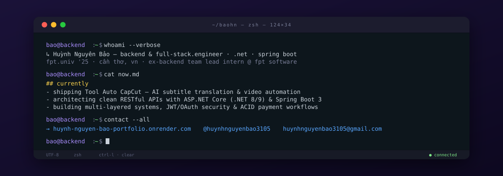

  

### projects on the desk

- **[Tool Auto CapCut](https://github.com/huynhnguyenbao3105/Tool-Auto-CapCut-Releases)** - AI-powered desktop suite (Win/macOS) for SRT subtitle translation, 4K video downloading, lossless keyframe clipping & CapCut PC automation · [`latest release`](https://github.com/huynhnguyenbao3105/Tool-Auto-CapCut-Releases/releases/latest)
- **[G1Mart E-Commerce](https://g1mart.netlify.app/)** - full-featured e-commerce platform & staff/admin portal built with `Spring Boot 3.3`, `PostgreSQL`, `React 18`, `JWT` & `VNPay` *(Backend Team Lead Intern @ FPT Software)* · [`gitlab`](https://gitlab.com/myproject31052003/G1Mart)
- **[AccountMarket](https://salegameaccount-aqlq.onrender.com/)** - game account marketplace with internal wallet, ACID transactions, idempotent `SePay` payment webhooks & GitLab CI SAST on `.NET 9` & `Azure SQL` · [`gitlab`](https://gitlab.com/myproject31052003/salegameaccount)
- **[FUS Learning Network](https://gitlab.com/g38592114/project)** - academic social network with real-time chat & notifications via `SignalR`, `ASP.NET Core (.NET 8)`, `Google OAuth` & `Azure Blob Storage`

### stack & tools

`C#` · `Java 17` · `JavaScript` · `.NET 8/9` · `ASP.NET Core API & MVC` · `Spring Boot 3` · `Spring Security` · `EF Core` · `SignalR` · `React 18` · `PostgreSQL` · `SQL Server` · `Azure SQL & Blob` · `Docker` · `GitLab CI`

### resume & links

[`🌐 portfolio`](https://huynh-nguyen-bao-portfolio.onrender.com) · [`📄 cv (vn)`](https://huynh-nguyen-bao-portfolio.onrender.com/assets/Huynh-Nguyen-Bao-VN.pdf) · [`📄 cv (en)`](https://huynh-nguyen-bao-portfolio.onrender.com/assets/Huynh-Nguyen-Bao-EN.pdf) · [`✉️ huynhnguyenbao3105@gmail.com`](mailto:huynhnguyenbao3105@gmail.com)
